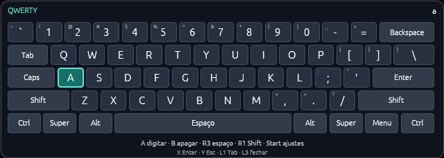

# Gamepad Desktop

Aplicativo Rust independente da extensão do navegador, planejado para Windows e Linux.

## Objetivo

- Ler controles conectados ao sistema operacional.
- Oferecer navegação item por item em elementos acessíveis da janela ativa.
- Oferecer um modo mouse para mover o ponteiro, clicar e rolar.
- Exibir um teclado visual próprio controlado pelo gamepad, sem tomar o foco do aplicativo ativo.
- Incluir páginas do navegador quando o navegador expuser seus elementos pela API de acessibilidade do sistema.

L3 abre um teclado próprio. No Windows e no Linux/X11 ele usa uma janela transparente, sempre no topo, sem foco e com os cliques do mouse repassados. Em Wayland, usa `wlr-layer-shell` com interação de teclado desativada e região de mouse vazia; o COSMIC atual oferece esse protocolo. O GNOME Wayland não oferece essa camada, então o teclado próprio informa que não está disponível nessa sessão. O app não muda o foco nem captura o campo de texto; os eventos de tecla seguem para o aplicativo que já estava ativo.

O teclado usa o bloco QWERTY ANSI com cinco fileiras alinhadas por unidades físicas: Tab à esquerda de Q, Caps à esquerda de A, dois Shift, Backspace, Enter e uma barra de espaço de 6,25 unidades. Ctrl, Alt e Super combinam com a próxima tecla e depois são liberados; Caps mantém maiúsculas e Shift vale para o próximo caractere. Esc continua disponível no botão superior do gamepad. No Windows, caracteres são enviados como Unicode. No Linux, o dispositivo `uinput` envia códigos de tecla do mapa US/QWERTY; layouts diferentes podem produzir símbolos diferentes e caracteres acentuados ainda precisam de suporte de layout.

O direcional move uma tecla por toque. Por padrão, segurar repete após 600 ms e depois a cada 400 ms. A navegação vertical considera a posição e a largura real das teclas e preserva a coluna ao atravessar a barra de espaço. As bordas laterais seguram a seleção. O tamanho padrão é 640 × 229 px, e as duas plataformas compartilham o mesmo desenho.

Com o teclado aberto, **Start** abre os ajustes: cima/baixo escolhe uma opção e esquerda/direita altera. Start volta à digitação e salva; L3 fecha e salva. Também existe a seção **Personalizar teclado QWERTY** no painel. É possível ajustar largura (520–1000 px, com altura proporcional), posição em cima/embaixo, opacidade, espera inicial, intervalo e desativar a repetição para avançar somente por toque. Os ajustes ficam em `~/.config/gamepad-navigator/keyboard.json` (ou `$XDG_CONFIG_HOME`) no Linux e `%APPDATA%/gamepad-navigator/keyboard.json` no Windows.

A pesquisa e as limitações de foco e layout estão em [KEYBOARD_RESEARCH.md](KEYBOARD_RESEARCH.md). Uma prévia do desenho real pode ser gerada no Linux com `cargo run --manifest-path desktop/Cargo.toml --example keyboard_preview`; os arquivos PPM ficam em `/tmp/gamepad-keyboard-preview`.

A navegação item por item depende do suporte de acessibilidade de cada aplicativo e navegador. No Linux, a árvore de acessibilidade costuma ser disponibilizada por AT-SPI. No Windows, navegadores podem expor informações por APIs diferentes, então o suporte deve ser validado por navegador.

O modo mouse também depende do sistema e do ambiente gráfico. Esta primeira entrega usa dispositivos virtuais via `uinput` no Linux. O XDG Desktop Portal permanece uma alternativa a avaliar para sessões Wayland compatíveis.

## Estado atual

O primeiro fluxo de desktop é o modo mouse: o app lê um controle do sistema e envia movimento, cliques, rolagem e teclas para a janela ativa. A leitura funciona em uma thread própria, inclusive quando o painel está em segundo plano ou recolhido na bandeja.

L3 abre ou fecha o teclado visual. Enquanto ele está aberto, o direcional move a seleção e A digita a tecla destacada; B apaga, X envia Enter, Y envia Esc, R3 envia espaço, L1 envia Tab e R1 alterna Shift. O controle deixa de mover o mouse nesse modo. A janela do teclado não recebe foco nem entrada do mouse, para que o cursor de texto e o ponteiro continuem pertencendo ao aplicativo ativo.

### Mapeamento inicial

| Controle                          | Ação                                              |
| --------------------------------- | ------------------------------------------------- |
| Analógico esquerdo                | Mover o ponteiro                                  |
| Analógico direito, vertical       | Rolar                                             |
| Botão inferior (A/✕; B no Switch) | Clique esquerdo; segurar para arrastar            |
| Botão direito (B/○; A no Switch)  | Clique direito                                    |
| Botão esquerdo (X/□; Y no Switch) | Enter / abrir o item selecionado                  |
| Botão superior (Y/△; X no Switch) | Escape / voltar                                   |
| Direcional                        | Setas, com repetição ao segurar                   |
| L3                                | Abrir / fechar o teclado visual próprio           |
| R3                                | Super / Windows, para abrir o lançador do sistema |
| LB / L1                           | Tab                                               |
| RB / R1                           | Alt+Tab                                           |
| Start / Menu                      | Pausar ou retomar o controle do desktop           |

Para abrir um programa: pressione R3, escolha um item com o direcional e confirme com o botão esquerdo; também é possível apontar e clicar com o botão inferior. O lançador e seu atalho precisam estar configurados no ambiente. No COSMIC desta máquina, Super está configurado para abrir o lançador.

O painel mostra os comandos do modo mouse e do teclado visual, com nomes por posição física e equivalentes de Xbox, PlayStation e Switch. As configurações e perfis ficam em seções expansíveis. Escape cancela menus/diálogos; não equivale a voltar no histórico do navegador.

No modo de teclado, o mouse fica pausado para evitar que o analógico mova o ponteiro por baixo das teclas. O teclado em Wayland só aparece em compositores com `wlr-layer-shell`; no GNOME Wayland essa garantia não está disponível. Se o protocolo não existir ou a camada falhar, o painel explica o motivo e o modo não envia teclas sem que o usuário veja o teclado.

Depois de conectar/reconectar ou retomar, solte os botões e centralize os analógicos antes de controlar o desktop. Pausa, desconexão e encerramento do app soltam os cliques mantidos. O painel permite ajustar velocidade e zona morta para a sessão. As preferências do teclado são salvas entre execuções.

### Bandeja do sistema

O **X** recolhe o painel e mantém o controle do desktop funcionando. O ícone de gamepad fica na bandeja, perto do relógio, com as ações **Abrir painel**, **Recolher painel** e **Encerrar aplicativo**. Também existe um botão de encerramento no próprio painel.

No Linux, a bandeja usa StatusNotifierItem sem exigir GTK. O ambiente precisa oferecer uma área de notificações compatível; o COSMIC desta máquina oferece. Quando a bandeja está disponível, fechar o painel o oculta e mantém o serviço e o teclado ativos; a ação **Abrir painel** restaura a janela. Se a criação da bandeja falhar, o painel mostra o erro e fechar a janela encerra o app para não deixá-lo sem acesso.

No Linux, o X permite fechar a janela nativa e o processo aguarda a reabertura pela bandeja, preservando o controle do desktop. No Windows, o painel é ocultado mantendo a fila de eventos da bandeja. Isso evita depender de `set_visible(false)`, que o Winit não suporta em Wayland.

### Integração com o sistema

- **Controles nos dois sistemas:** SDL3 lê e normaliza botões/eixos e habilita eventos em segundo plano. A escolha substitui a leitura manual de evdev e a restrição a XInput. Os perfis e drivers da SDL cobrem diversas famílias, como Xbox, DualShock/DualSense, Switch Pro, 8BitDo e genéricos, conforme o dispositivo, conexão e suporte do sistema.
- **Saída no Linux:** `evdev/uinput` cria mouse e teclado virtuais para Wayland e X11, dependendo do compositor e das permissões. É necessário acesso a `/dev/uinput` e aos dispositivos de entrada usados pela SDL; alguns controles também exigem acesso a HID. O app não altera permissões automaticamente.
- **Teclado e saída no Windows:** `enigo` envia entrada nativa, incluindo caracteres Unicode; a janela egui é criada sem ativação, sempre no topo e com cliques repassados. A entrada em programas executados com privilégios maiores pode ser bloqueada pelo Windows.
- **Teclado e saída no Linux:** `evdev/uinput` envia teclas. Em Wayland, a camada de teclado é renderizada em software e não recebe foco nem eventos do mouse; precisa de `wlr-layer-shell`. GNOME Wayland não anuncia esse protocolo. Em X11, o teclado usa uma janela egui sem foco e sempre no topo.

### Escolha do controle e perfis

O seletor permite usar detecção automática ou escolher um dispositivo. No modo automático, o primeiro controle com perfil é usado; reconexões são detectadas. A seleção explícita usa o identificador da sessão: se esse controle for desconectado, escolha-o novamente após reconectar. O app não troca silenciosamente para outro controle.

Modelos desconhecidos que a SDL detecta aparecem com **precisa de perfil**. Em **Perfis de controles**, o painel mostra o GUID do dispositivo e aceita uma linha de mapeamento SDL. **Aplicar e salvar perfil** valida a linha, aplica o mapeamento e salva para a próxima execução em:

- Linux: `$XDG_CONFIG_HOME/gamepad-navigator/gamecontrollerdb.txt` ou `~/.config/gamepad-navigator/gamecontrollerdb.txt`.
- Windows: `%APPDATA%/gamepad-navigator/gamecontrollerdb.txt`.

Essa configuração inicial ainda exige importar um perfil textual. O assistente visual para aprender botões/eixos e calibrar modelos desconhecidos continua no TODO. Não há garantia de suporte a todo hardware: o dispositivo precisa estar acessível ao sistema/SDL e ter um perfil adequado.

A navegação item por item pela árvore de acessibilidade continua no plano. O teclado visual está implementado, mas a validação com controle físico, cursor de texto e aplicativos reais continua pendente em Windows, X11 e Wayland. Em Linux, a compatibilidade com layouts não US e acentos também está pendente.

O plano completo está em [TODO.md](TODO.md).

Para abrir o protótipo, execute `cargo run --manifest-path desktop/Cargo.toml` na raiz do repositório.

O pacote `desktop/dist/GamepadNavigator-Windows-x64.zip` contém o `.exe` GUI x64 atualizado, compilado para `x86_64-pc-windows-gnu` com SDL3 estática. Para compilar no Linux, instale CMake e o compilador cruzado MinGW x64; no Windows, use um compilador C/C++ compatível com CMake. A validação de execução com controle físico no Windows 11 continua pendente.

A compilação padrão inclui SDL3 a partir do código-fonte e exige CMake e um compilador C/C++, além do Rust. Os subsistemas de entrada/HID são incluídos; a interface continua em egui/eframe. Com SDL3 já instalada, `--no-default-features` permite usar a biblioteca externa.

### Validação

Execute `cargo test --manifest-path desktop/Cargo.toml`, `cargo fmt --manifest-path desktop/Cargo.toml --check` e `cargo clippy --manifest-path desktop/Cargo.toml --all-targets -- -D warnings`.

Os testes nativos são optativos: `cargo test --manifest-path desktop/Cargo.toml --lib -- --ignored --test-threads=1`. Eles verificam a identificação de mouse/teclado pelo udev, leitura e desconexão por SDL, importação de perfil para controle virtual desconhecido e leitura de um controle físico. Exigem `/dev/uinput`, `udevadm` e um controle físico conectado para o teste correspondente. Os testes também cobrem L3 sem repetição por pressão longa, movimento do ponteiro no modo de teclado por mouse, repasse do controle no modo COSMIC, liberação do arrasto e pausa/desconexão. A validação manual das ações no desktop continua necessária.

A bandeja já foi validada no COSMIC/Wayland em uma versão anterior: registro do ícone/menu, recolhimento e reabertura mantendo o mesmo processo e dispositivos virtuais, e encerramento removendo os dispositivos. Os builds release Linux e Windows x64 terminaram com sucesso, e o ZIP Windows foi atualizado. Linux/X11, foco/caret, teclado com controle físico e execução com controle físico no Windows 11 ainda precisam de validação manual.

Na sessão gráfica, conecte um controle, abra o app, mova o ponteiro, arraste uma janela segurando o botão inferior, role uma página, abra o lançador com R3 e inicie um programa com o direcional e o botão esquerdo. Foque um campo de texto e pressione L3. Confirme que o teclado próprio não toma o foco, que o ponteiro continua visível e que A escreve no cursor original. Teste Shift, símbolos, Backspace, Enter, Esc e um campo de senha. No Linux, valide também um layout não US e anote o suporte a acentos; em Wayland, confirme que o compositor oferece `wlr-layer-shell`. Feche o painel e confira a reabertura pela bandeja. Pause durante um arrasto e desconecte/reconecte para conferir a recuperação.

## Referências

- [Acessibilidade do Chromium](https://new.chromium.org/developers/design-documents/accessibility/)
- [AT-SPI2 no Linux](https://wiki.freedesktop.org/www/Accessibility/AT-SPI2/)
- [`wlr-layer-shell` protocol](https://github.com/wlroots/wlroots/blob/master/protocol/wlr-layer-shell-unstable-v1.xml)
- [Smithay Client Toolkit](https://docs.rs/smithay-client-toolkit/latest/smithay_client_toolkit/shell/wlr_layer/index.html)
- [egui software backend](https://docs.rs/egui_software_backend/latest/egui_software_backend/)
- [eframe](https://docs.rs/eframe/latest/eframe/)
- [egui ViewportBuilder](https://docs.rs/egui/latest/egui/viewport/struct.ViewportBuilder.html)
- [evdev e dispositivos virtuais](https://docs.rs/evdev/latest/evdev/uinput/)
- [SDL3: gamepads e perfis](https://wiki.libsdl.org/SDL3/CategoryGamepad)
- [SDL3: eventos de controle em segundo plano](https://wiki.libsdl.org/SDL3/SDL_HINT_JOYSTICK_ALLOW_BACKGROUND_EVENTS)
- [Enigo](https://docs.rs/enigo/latest/enigo/)
- [Especificação de gamepads do Linux](https://docs.kernel.org/input/gamepad.html)
- [tray-icon: Windows e StatusNotifierItem no Linux](https://docs.rs/tray-icon/latest/tray_icon/)
